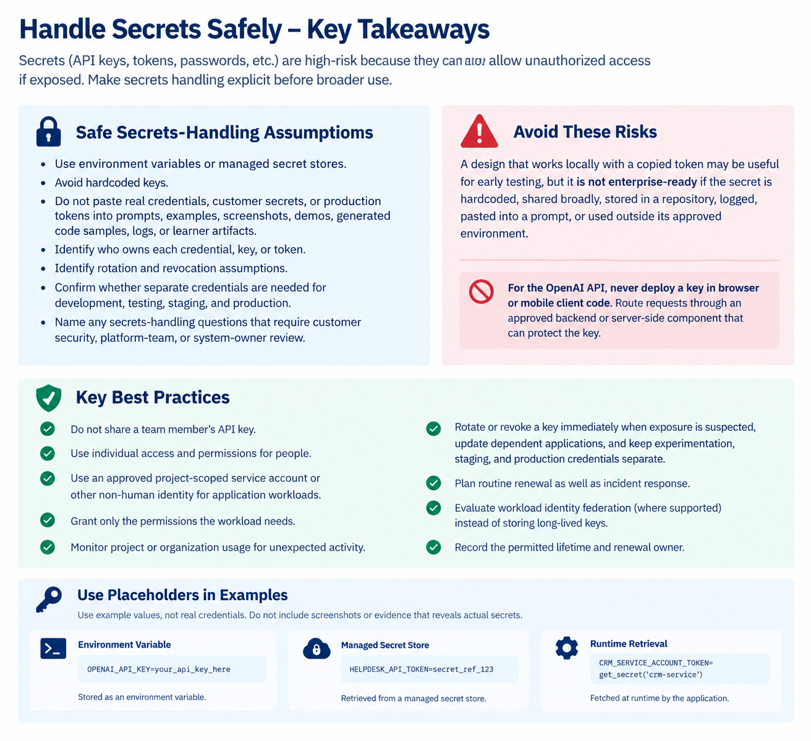

### Summary: Authentication, Authorization, and Secrets Handling

In enterprise API workflows, it is important to define access controls clearly, not just ensure that the API works.

- Authentication: Verifies who or what is accessing the API.
- Authorization: Determines what resources and actions the authenticated caller is allowed to access.
- Secrets handling: Ensures credentials, API keys, tokens, and passwords are stored and protected securely.
- Least privilege: Gives each user or system only the minimum access required to perform its tasks.

Key takeaway: Make access-control assumptions clear and have the technical, platform, security, and system-owner teams validate them. The goal is to identify and review security requirements, not to design a complete identity architecture.

### Summary: Key Definitions

- Authentication: Verifies who or what is calling the API.
- Authorization: Determines what the caller is permitted to access or do.
- Secrets: Sensitive credentials such as API keys, tokens, passwords, and certificates that must be securely protected.
- Least privilege: Grants only the minimum access necessary to complete the workflow.
- Auditability: Maintains reviewable evidence of actions, identities, decisions, and approvals.

Key takeaway: Authentication confirms the caller's identity, but it does not guarantee safety. Authorization controls the caller's permissions, while secrets handling, least privilege, and auditability help ensure secure and accountable API workflows.

### Summary: Authentication vs. Authorization

- Authentication verifies who or what is making an API request.
- Authorization determines what the authenticated caller is allowed to access or do.

A valid login, token, or service account does not automatically grant permission to access sensitive data, modify production systems, or perform administrative actions.

When reviewing an API workflow:

1. Identify the caller: User, application, service account, internal system, external system, or another API.
2. Verify authentication: Understand how the caller's identity is confirmed.
3. Review authorization: Identify the caller's permissions and ensure they are limited to the workflow's needs.
4. Protect sensitive actions: Separate routine tasks from privileged operations.
5. Validate access rules: Check whether permissions vary by role, customer, region, system, or environment.
6. Confirm approvals and evidence: Identify who approves production access and what audit records demonstrate proper control.

Key takeaway: A valid token proves the caller is recognized, not that every requested action is permitted. Both authentication and authorization must be validated before enterprise deployment.

### Summary: Apply Least Privilege

Least privilege means giving an API caller only the minimum permissions needed to complete its workflow.

Key practices:

- Limit permissions: Grant only the required read, write, or admin access.
- Scope access: Restrict permissions by role, system, environment, customer, region, or workflow where appropriate.
- Require approvals: Obtain human approval for sensitive actions when necessary.
- Separate environments: Keep development, testing, staging, and production access separate.
- Validate assumptions: Involve security, privacy, legal, platform, and system-owner teams before deployment.

For the OpenAI platform:

- Prefer project-level access over organization-wide access when possible.
- Assign roles with only the necessary permissions.
- Separate experiments, staging, and production into different projects.
- Scope API keys and service accounts to the required project and operations.
- Regularly review unused roles and keys, and test permissions with a non-owner account.

Example: If a workflow only needs to read a support ticket's category and update its routing label, it should not be allowed to delete records, export attachments, or modify user profiles.

Important: Effective access depends on all assigned roles and applicable API key permissions. Test both allowed and denied requests before deployment.

Key takeaway: Make access assumptions explicit, restrict permissions to the workflow's needs, and validate them with the appropriate teams before enterprise deployment.

### Summary: Review Pattern — Access and Secrets Boundary

The goal is to identify who can access an API, what permissions they have, how secrets are protected, and whether access is limited to what the workflow needs.

Key review questions:

1. Who is acting? Identify the user, application, service account, or system calling the API.
2. What boundary applies? Identify the OpenAI organization, project, and environment.
3. What permissions are needed? Define minimum read, write, and administrative access.
4. Which roles and API key permissions apply? Check project roles, key permissions, and combined access from multiple roles.
5. Where is access too broad? Identify shared accounts, excessive permissions, unnecessary record access, and unapproved production access.
6. How are secrets protected? Ensure keys and tokens are stored securely, not hardcoded, logged, or reused across environments without approval.
7. Can client-side code expose the key? Never embed OpenAI API keys in browser or mobile applications. Use an approved backend to protect them.

Key takeaway: A strong access-and-secrets boundary makes identities, permissions, risks, and secret-handling assumptions explicit so the security, platform, and system-owner teams can validate them before deployment.

## Access and Secrets Boundary — Exercise Answers

1\. Caller or service identity:

- Helpdesk API: a shared service account.
- OpenAI API: a developer’s personal API key embedded in the browser-based demo.
- Recommended: use a dedicated, approved non-human service identity for application workloads.

2\. Required permissions:

- Read only approved pilot support tickets.
- Generate draft triage summaries or categories.
- Write draft results only where necessary, after staff review.
- No unrestricted ticket access, deletion, user-profile modification, or administrative permissions.

3\. Permission or access concern:

The helpdesk service account has broad read and write access to all tickets, exceeding the workflow’s needs. Production write access also lacks a named approver. Scope permissions to approved pilot tickets and permitted actions.

4\. Secrets-handling concern:

- The helpdesk token is stored in a local configuration file.
- The same token is used for testing and planned production.
- Full request and response logging may expose sensitive data or credentials.
- The OpenAI key is a personal key embedded in client-side code.
- Testing and production share the same OpenAI project and key.

5\. Required remediation:

- Store secrets in an approved managed secret store or secure runtime configuration.
- Separate testing and production credentials and, where appropriate, projects.
- Restrict helpdesk permissions to approved pilot tickets and necessary actions.
- Redact secrets and sensitive data from logs.
- Name the production write-access approver.
- Require staff review before draft results are applied to tickets.

6\. OpenAI organization/project boundary:

Identify the responsible OpenAI organization and project. Prefer separate projects for testing and production, with appropriate access controls, scoped API keys, and named owners. Review project roles and key permissions before deployment.

7\. OpenAI caller identity and client-side key exposure concern:

The current caller uses a developer’s personal API key in browser code. This is a deployment blocker because users can extract the key from the client.

Move OpenAI API calls to an approved backend, protect the key server-side, and use an approved project-scoped identity and least-privilege permissions. If the exposed key is real, revoke or rotate it.

8\. Usage monitoring, rotation, or revocation action:

- Assign an owner for monitoring OpenAI usage and investigating unexpected activity.
- Review usage for suspicious or unauthorized requests.
- Rotate or revoke exposed keys immediately and update dependent applications.
- Define routine key renewal, expiry tracking, and revocation procedures.
- Verify that testing and production use separate credentials.

### Optional stretch: Least-privilege rule

Rule: The workflow may read only approved pilot tickets and save draft triage results; staff approval is required before applying changes to live tickets.

| Test                                                                  | Expected outcome                               |
| --------------------------------------------------------------------- | ---------------------------------------------- |
| Allowed: Read an approved pilot ticket and generate a draft category. | Permit, subject to the configured permissions. |
| Denied: Read a ticket outside the approved pilot scope.               | Deny access.                                   |

Evidence to collect: API authorization logs, ticket-scope checks, permission configuration, and records of staff approval. These are planned tests; results must be verified during implementation.

Final takeaway: The prototype is not ready for production until excessive access is reduced, secrets are protected, the client-side OpenAI key exposure is resolved, and monitoring and approval ownership are established.